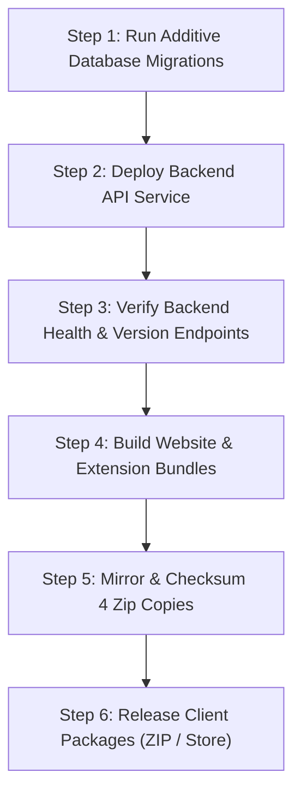

# LeetStreak Release & Version Management Procedure

This document specifies the authoritative procedure for releasing LeetStreak updates across backend services, the web application, and the browser extension package.

---

## 1. Authoritative Release Metadata

All version numbers, release notes, update instructions, and artifact checksums originate from a **single source of truth**:
- **Source File**: `backend/app/release_metadata.py`
- **Canonical Version Variable**: `SEMANTIC_VERSION` (Semantic Versioning 2.0.0 format: `MAJOR.MINOR.PATCH`)
- **Compatibility Floor**: `MIN_SUPPORTED_VERSION` (Oldest client version allowed to interact with the backend API)
- **API Endpoint**: `GET /api/extension/version`

All other manifests and package files MUST strictly agree with this source:
- `extension/manifest.json` (`version`)
- `extension/package.json` (`version`)
- `web/package.json` (`version`)
- `backend/app/main.py` (`/api/config/app` dynamic config)

---

## 2. Release Channels & Branching Strategy

| Channel / Branch | Target Audience | Policy & Constraints |
|---|---|---|
| **Development (`pre-launch` / feature branches)** | Maintainers & CI | Used for incremental milestones, integration testing, and synthetic verification. **Never deploy directly to production or public stores from unmerged branches.** |
| **Stable (`main`)** | Production Users | Merged only after 100% test pass rate across backend unit tests, PostgreSQL migration checks, client test suites, and browser smoke tests. Triggers production deployment on Render. |
| **Release Tags (`vX.Y.Z`)** | Permanent Archive | Immutable Git tags matching `SEMANTIC_VERSION`. Created upon verified production deployment. |

---

## 3. Rollback-Compatible Deployment Order

Because browser extensions and cached website clients update asynchronously on user-controlled schedules, the backend API **must always maintain backward compatibility** with existing clients (`min_supported_version <= client_version <= latest_version`).

### Safe Deployment Steps:



1. **Step 1 — Additive Database Migrations:**
   - Database schema changes must be backward-compatible (e.g. nullable new columns or columns with defaults).
   - Never drop columns, rename columns, or make nullable fields non-nullable in the same release where code begins depending on them.
2. **Step 2 — Deploy Backend API Service:**
   - Deploy backend to Render/production host.
   - The updated API serves both new endpoints and legacy-compatible fallback structures for older clients.
3. **Step 3 — Verify Backend Health & Metadata:**
   - Verify `GET /api/health` returns `200 OK`.
   - Verify `GET /api/extension/version` returns the new `latest_version`, valid commit hash, and artifact checksums.
4. **Step 4 — Build Client Bundles:**
   - Web application: `npm --prefix web run check && npm --prefix web run build`.
   - Extension: `npm --prefix extension run build`.
5. **Step 5 — Synchronize & Checksum Packages:**
   - Package `extension/dist` into `leetstreak.zip`.
   - Mirror byte-identically across all 4 required locations:
     1. `./leetstreak.zip`
     2. `./leetstreak_dist.zip`
     3. `./extension/leetstreak.zip`
     4. `./backend/app/leetstreak.zip`
   - Verify all 4 copies have identical MD5 and SHA-256 hashes.
6. **Step 6 — Rollback Procedure (If Necessary):**
   - If an unexpected backend bug arises post-deploy, rollback the backend service. Because database migrations were additive, the previous backend revision will continue operating safely.
   - If a client defect is found, older clients remain functional because the backend honors `min_supported_version`.

---

## 4. Distribution Channels & Update Truthfulness

### Manual Unpacked ZIP Channel (Developer Mode)
- **Distribution URL**: `https://codestreak-api.onrender.com/downloads/leetstreak.zip`
- **Update Mechanism**: Chromium-based browsers (Chrome, Edge, Brave) and Firefox **do not silently auto-update unpacked extensions loaded in Developer Mode**.
- **User Instructions**:
  1. Download the updated `leetstreak.zip`.
  2. Extract files into the existing extension directory.
  3. Navigate to `chrome://extensions` and click the **Reload icon** (🔄) on the LeetStreak card.
- **Client In-App Banner**:
  - Compares `currentVer` against `latest_version`. If newer, renders an update notice with a direct ZIP download button and step-by-step reload guide.
  - Compares `currentVer` against `min_supported_version`. If unsupported, renders a critical warning banner explaining that the installed version requires updating to remain compatible.

### Chrome Web Store Channel (Official Store Releases)
- Once published to the Chrome Web Store, updates are automatically fetched and applied by the browser in the background.
- Manual reload steps are omitted for store-managed installations.

### Deprecated CRX / Omaha XML Endpoints
- The legacy `/api/extension/updates.xml` endpoint returns `410 Gone`. Unpacked extensions cannot be auto-updated via Omaha XML without signed CRX store certificates. Fictitious `.crx` URLs are removed.

---

## 5. Automated Verification Checklist

Before tagging or deploying a release, execute the verification suite:

```bash
# 1. Validate version alignment and zip byte-synchronization
python3 scripts/sync_release.py --verify

# 2. Run backend test suite (including coordination and release metadata tests)
PYTHONPATH=backend:backend/tests test_env/bin/python -m unittest discover -s backend/tests -p "test_*.py"

# 3. Run client unit tests
node --test extension/tests/*.test.mjs

# 4. Verify web build and extension build
npm --prefix web run check
npm --prefix web run build
npm --prefix extension run package
```
